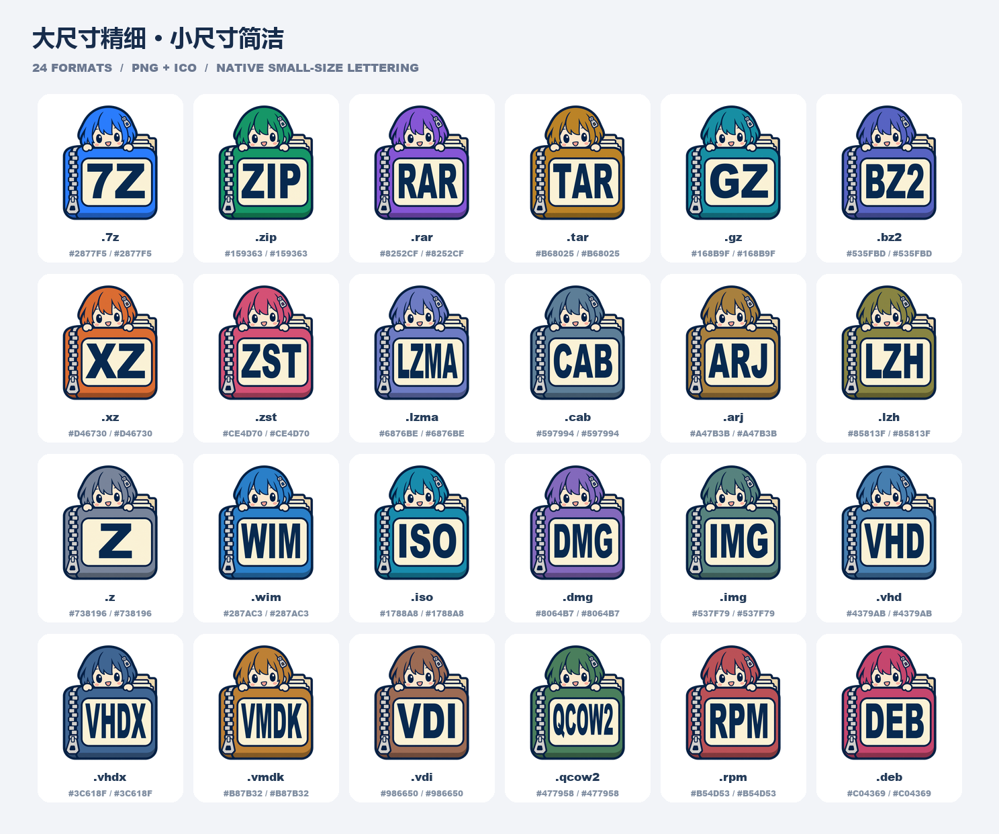
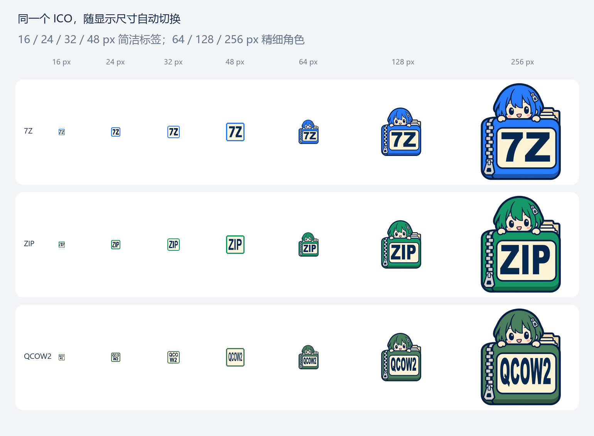
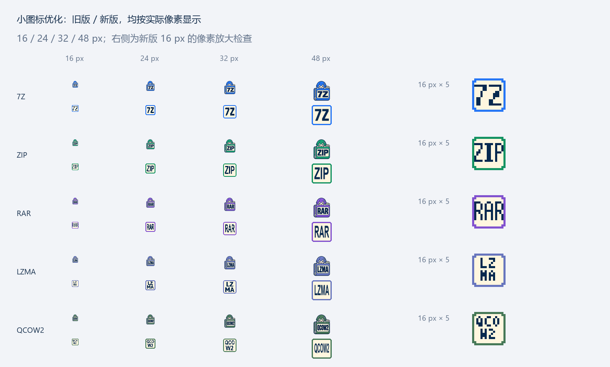
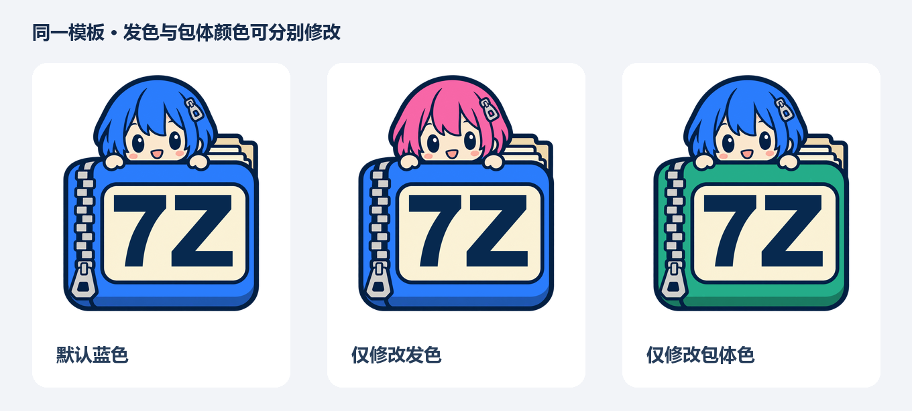

# 压缩包娘图标工具 · Archive Moe Icons

一套随显示尺寸自动切换的 Windows 文件图标与离线批量改色工具。小尺寸使用清晰的格式文字和主题色框，大尺寸保留精细的「压缩包娘」角色图案。

包含 **24 种格式的透明 PNG、7 尺寸 ICO、独立改色工具，以及自动应用 / 恢复文件图标的脚本**。



## v1.1.0：小尺寸简洁，大尺寸精细

默认成品将两套画面放进同一个 ICO：**16、24、32、48 px 使用简洁标签，64、128、256 px 使用精细角色**。Windows 根据请求的图标尺寸选取对应图像，切换文件夹的查看大小时无需手动更换图标。



- **16 px**：按像素网格绘制不透明笔画，避免文字被抗锯齿冲淡。
- **16 / 24 / 32 px 长标签**：完整分成两行，例如 `LZ / MA`、`QCO / W2`，不缩写或丢弃字符。
- **48 px**：保留主题色与单行格式文字，去掉人物、拉链、纸页、渐变和阴影。
- **64 px 及以上**：保留角色、发色、包体颜色和大标签。
- **7 个尺寸独立保存**：ICO 中保留各自的实际画面，工具底部也展示对应尺寸，避免导出或预览时重新缩小大图。



对比图每行上方是 v1.0.0、下方是新版；右侧为新版 16 px 的 5 倍像素放大图。

## 下载

前往 [Releases](https://github.com/ichizxy/archive-moe-icons/releases/latest) 下载：

- `archive-moe-icons-v1.1.0.zip`：完整项目，含图标、改色工具、自动替换脚本和文档。
- `archive-moe-icons-ico-v1.1.0.zip`：仅 ICO 图标及预览，适合手动设置图标。

解压完整包到固定位置后再应用图标。注册表会记录 ICO 的完整路径；移动目录后，需要在新位置重新运行应用脚本。

## 功能

- **格式标签优先**：简洁的主题色框与高对比度大字，长格式名称完整显示。
- **三种风格**：自动切换（默认）、全部简洁文字、全部角色图标。
- **独立配色**：主题色和点缀色可分别选择；角色模式下对应包体色与发色。
- **批量导出**：一次生成全部格式的 PNG、ICO、预览图、配色 JSON 和 ZIP。
- **可扩展格式**：新增标签、保存配色方案、重新载入继续编辑。
- **自动替换和恢复**：检测当前用户已关联到 7-Zip 的格式，先备份，再应用图标，支持预览模式和恢复首次配置。

## 使用流程

### 1. 应用现成图标

只应用现成图标不需要安装 Python；使用 Windows PowerShell 5.1 或 PowerShell 7 即可。

1. 将完整包解压到固定目录。
2. 双击 **`预览图标替换.cmd`**，查看将处理的格式与注册表图标项。这一步只预览，不写入配置或备份。
3. 双击 **`应用文件图标.cmd`**。脚本会先保存备份，再替换当前用户的文件图标，并通知资源管理器刷新。
4. 重新打开文件夹查看效果。

默认只处理当前关联的 ProgID 为 `7-Zip.*` 的文件类型；未关联到 7-Zip 的格式会跳过。如需处理某种格式，先在 **7-Zip → 工具 → 选项 → 系统**中设置该格式的关联，再重新预览。

脚本写入当前用户的 `Software\Classes\…\DefaultIcon`，包含对应 ProgID 和扩展名的图标项。它保留文件的打开命令和默认打开方式，通常无需管理员权限。

### 2. 恢复原图标

双击 **`恢复原图标.cmd`**。

默认读取 `本地备份/original-icons.json`，恢复每个图标项首次被本工具处理前的配置。后续多次换色、重复应用不会覆盖已有的首次备份；新增处理的格式会补入首次备份。

每次应用前还会保存独立的 `apply-*.json` 会话快照，便于回到某次应用前的状态：

```powershell
# 在项目根目录的 PowerShell 中执行
Set-ExecutionPolicy -Scope Process Bypass
& ".\工具\恢复图标.ps1" -BackupPath ".\本地备份\apply-具体时间和编号.json" -WhatIf
& ".\工具\恢复图标.ps1" -BackupPath ".\本地备份\apply-具体时间和编号.json"
```

备份与当前 Windows 用户绑定。备份目录不会提交到 GitHub；恢复时保留其他程序后来增加的注册表值和子项。

### 3. 自主修改颜色与标签

需要 **Python 3.10+、Tkinter、Pillow、NumPy**。官方 Windows Python 安装程序通常包含 Tkinter。

在项目根目录安装依赖：

```powershell
python -m pip install -r requirements.txt
```

双击 **`启动工具.cmd`**，然后：

1. 在左侧选择格式。
2. 在预览区上方选择风格，再修改标签和颜色，实时查看效果。
3. 点击「导出当前 PNG + ICO」导出一个格式，或点击「批量导出整套 + ZIP」生成全部格式。
4. 使用「保存配色方案」保存 JSON，之后可重新载入。

默认选择「自动切换（推荐）」：同一个 ICO 在 16～48 px 使用简洁画面，64 px 及以上保留角色，也可选择「全部简洁文字」或「全部角色图标」。简洁版中的点缀色仅在 32 px 及以上、且与主题色不同时显示，避免干扰更小的文字。



启动器会从 `PATH` 和 Windows `py` 启动器中寻找可用 Python。需要指定 Python 时，可设置环境变量 `ARCHIVE_MOE_PYTHON` 为对应 `python.exe` 的完整路径。

工具离线运行，无需登录或调用图像生成 API。简洁版按尺寸直接绘制，角色版使用包内底图改色和排版。

### 4. 应用自己导出的图标

先按下一节的命令导出到 `导出图标/my-icons`，再执行：

```powershell
Set-ExecutionPolicy -Scope Process Bypass
& ".\工具\应用图标.ps1" -IconDirectory ".\导出图标\my-icons\ico" -WhatIf
& ".\工具\应用图标.ps1" -IconDirectory ".\导出图标\my-icons\ico"
```

也可仅处理指定格式：

```powershell
& ".\工具\应用图标.ps1" -Formats 7z,zip,rar -WhatIf
& ".\工具\应用图标.ps1" -Formats 7z,zip,rar
```

## 命令行批量生成

在项目根目录执行：

```powershell
python ".\工具\icon_customizer.py" --export ".\导出图标\my-icons"

# 使用自定义配色方案
python ".\工具\icon_customizer.py" --palette ".\配色方案\my-palette.json" --export ".\导出图标\my-icons"

# 全部尺寸使用简洁标签
python ".\工具\icon_customizer.py" --style compact --export ".\导出图标\compact-icons"

# 全部尺寸使用原角色
python ".\工具\icon_customizer.py" --style character --export ".\导出图标\character-icons"
```

输出包含 `png/`、`ico/`、`preview.png`、`palette.json`、`rendering.json`，并生成同名 ZIP；`rendering.json` 记录本次风格和尺寸。默认风格为 `adaptive`，也可显式指定 `--style adaptive`。

## 配色方案

默认方案位于 `配色方案/默认配色.json`：

```json
[
  {
    "id": "7z",
    "label": "7Z",
    "hair": "#2877F5",
    "body": "#2877F5",
    "extensions": ["7z"]
  }
]
```

| 字段 | 用途 |
| --- | --- |
| `id` | 唯一输出文件名；字母、数字、下划线或短横线 |
| `label` | 图标上的大标签，1～8 个字母、数字或 `. + _ -` |
| `hair` | 角色发色 / 简洁版点缀色，`#RRGGBB` |
| `body` | 包体色 / 格式主题色，`#RRGGBB` |
| `extensions` | 自动应用脚本使用的参考扩展名，不含开头的点 |

改色工具可以新增格式；自动应用脚本的格式映射读取默认配色 JSON。如需让新增格式参与自动应用，应将映射保存到默认方案，并为它提供同名 ICO。

## 内置格式

`7Z`、`ZIP`、`RAR`、`TAR`、`GZ`、`BZ2`、`XZ`、`ZST`、`LZMA`、`CAB`、`ARJ`、`LZH`、`Z`、`WIM`、`ISO`、`DMG`、`IMG`、`VHD`、`VHDX`、`VMDK`、`VDI`、`QCOW2`、`RPM`、`DEB`。

每个 ICO 包含 **16、24、32、48、64、128、256 px** 的独立透明图像。默认成品在前四个尺寸使用简洁标签，后三个尺寸使用角色图案；1024 px PNG 为精细角色图案。自动切换由支持多尺寸 ICO 的 Windows 图标视图完成，PNG 是单张图像，不会切换。

## 目录结构

```text
archive-moe-icons/
├─ README.md
├─ requirements.txt
├─ 启动工具.cmd
├─ 预览图标替换.cmd
├─ 应用文件图标.cmd
├─ 恢复原图标.cmd
├─ 工具/                 # 改色程序、启动脚本与图标应用/恢复脚本
├─ 成品图标/
│  ├─ PNG/               # 24 张 1024 px 精细角色透明图
│  └─ ICO/               # 24 个自动切换的多尺寸 Windows 图标
├─ 预览图/
├─ 配色方案/
├─ 模板素材/             # 无字基础图
├─ 生成提示词/
├─ 导出图标/             # 本地导出结果，不提交生成文件
├─ 本地备份/             # 首次备份和会话快照，执行应用后生成
└─ tests/                # 图像导出和注册表备份/恢复测试
```

## 常见问题

**脚本提示没有找到目标格式**

先检查该格式是否已关联到 7-Zip。脚本尊重当前用户的文件关联，跳过其他应用管理的类型。

**图标没有立即更新**

更新到新版后重新运行 `应用文件图标.cmd`，再打开文件夹；若资源管理器仍缓存旧图标，可注销后重新登录。脚本已调用系统图标变更通知。

**文件夹移动后图标不显示**

从新位置再次运行应用脚本，以更新 ICO 的完整路径。

**只想用现成图标**

下载完整包后直接使用应用脚本即可，无需安装 Python。也可下载仅 ICO 的包自行设置。

## 开发与验证

```powershell
python -m unittest discover -s tests -p "test_*.py" -v
powershell.exe -NoProfile -ExecutionPolicy Bypass -File ".\tests\Test-IconScripts.ps1"
python ".\工具\icon_customizer.py" --smoke-ui
```

注册表测试使用临时、未关联到真实文件的测试类，并在结束后恢复和清理；实际图标应用另以 `-WhatIf` 检查，不在测试中替换真实格式图标。

原角色底图使用 imagegen 制作，提示词保存在 `生成提示词/`；新版简洁图标由 `工具/compact_icons.py` 按像素尺寸直接绘制。图标应用方式依据 Microsoft 的 [文件类型注册说明](https://learn.microsoft.com/en-us/windows/win32/shell/fa-file-types)、[自定义文件类型图标](https://learn.microsoft.com/en-us/windows/win32/shell/how-to-assign-a-custom-icon-to-a-file-type)和 [SHChangeNotify](https://learn.microsoft.com/en-us/windows/win32/api/shlobj_core/nf-shlobj_core-shchangenotify) 文档实现。
